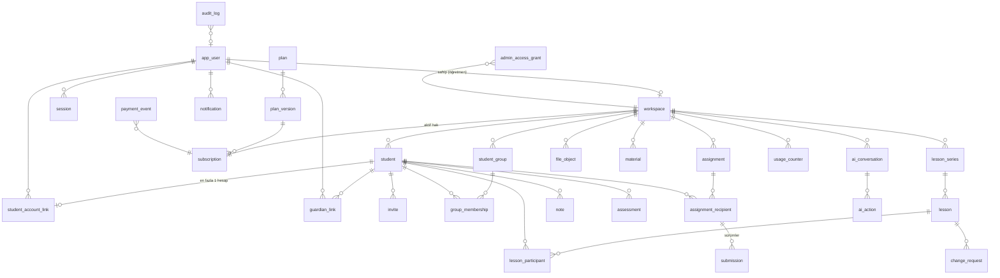

# Veri Modeli

Kaynak: `apps/api/src/db/schema.ts` (Drizzle) ve `apps/api/drizzle/*.sql` (migration). Tüm kimlikler UUID v7 değil, `gen_random_uuid()` (v4). Zamanlar `timestamptz`.

## Tablolar ve önemli kısıtlar

| Tablo | Amaç | Önemli kısıt / indeks |
|---|---|---|
| `app_user` | Tüm hesaplar | `lower(email)` unique; `is_admin`; `status` (active/suspended/deleted); `password_hash` argon2id |
| `session` | Refresh token | `token_hash` unique; `expires_at`; `revoked_at` |
| `email_token` | Doğrulama/sıfırlama | `token_hash` unique, `purpose`, tek kullanım |
| `workspace` | Öğretmen çalışma alanı | `owner_user_id` unique (ilk sürümde öğretmen başına 1); `timezone`; limit kilidi bu satırda |
| `student` | Öğretmene ait öğrenci kaydı | `(workspace_id, status)` indeks; `display_name` zorunlu; diğerleri null |
| `student_account_link` | Öğrenci kaydı ↔ öğrenci hesabı | `student_id` unique (aktif); `(user_id, workspace_id)` unique |
| `guardian_link` | Öğrenci kaydı ↔ veli hesabı | `(student_id, user_id)` unique; `can_request_changes` |
| `invite` | Davet | `code_hash` unique; `kind` (student/guardian); `expires_at`, `revoked_at`, `accepted_at`, `accepted_by` |
| `student_group`, `group_membership` | Gruplar | `(group_id, student_id) WHERE left_at IS NULL` unique |
| `lesson_series` | Haftalık tekrar kuralı | `weekdays int[]`, `local_start_time`, `duration_min`, `timezone`, `starts_on`, `until_date` / `occurrence_count` |
| `lesson` | Somut ders oturumu | `EXCLUDE gist (workspace_id =, tstzrange(starts_at, ends_at,'[)') &&) WHERE status <> 'cancelled'`; `(workspace_id, starts_at)` indeks; `student_id` XOR `group_id` CHECK |
| `lesson_participant` | Katılımcı + yoklama | `(lesson_id, student_id)` PK |
| `change_request` | İptal/erteleme talebi | `status` pending/approved/rejected/withdrawn; aynı derste kişi başı 1 bekleyen |
| `note` | Not | `visibility` private/student/student_guardian; `kind` |
| `assessment` | Değerlendirme | `score numeric NULL`, `max_score NULL`, `visibility` |
| `assignment` | Ödev | `status` draft/published; `due_at NULL`; `answer_key_*`, `answer_key_visibility` hidden/after_review/at_date |
| `assignment_recipient` | Öğrenci bazlı durum | `(assignment_id, student_id)` unique; `status` |
| `submission` | Teslim sürümü | `(recipient_id, version)` unique |
| `assignment_feedback` | Geri bildirim | recipient + submission sürümüne bağlı |
| `file_object` | Dosya metadata | `storage_key`, `mime`, `size`, `owner_workspace_id`, `purpose` |
| `attachment` | Dosya ↔ kayıt bağlantısı | polimorfik (`entity_type`, `entity_id`) |
| `material` | Öğretmen materyal arşivi | workspace'e özel |
| `notification` | Uygulama içi bildirim | `(user_id, dedupe_key)` unique; `(user_id, read_at, created_at)` indeks |
| `notification_pref` | Tercihler | `(user_id, category)` PK |
| `plan`, `plan_version` | Paketler | sürümlü; fiyat `NULL` = belirlenmedi |
| `subscription` | Workspace hakkı | `workspace_id` unique; `status`; `current_period_end` |
| `payment_event` | Sağlayıcı olayları | `(provider, event_id)` unique → idempotent |
| `usage_counter` | AI kotası | `(workspace_id, metric, period)` PK |
| `ai_conversation`, `ai_message` | Öğretmen AI sohbeti | workspace + user'a özel |
| `ai_action` | Önizleme/onay | `status` proposed/applied/rejected/expired/stale; `payload_hash`; `applied_result` |
| `idempotency_key` | İstek tekrarları | `(user_id, key)` PK; yanıt önbelleği |
| `admin_access_grant` | Destek erişimi | öğretmen onaylı, süreli, gerekçeli |
| `audit_log` | Denetim | yönetici işlemleri, destek erişimi, kalıcı silmeler |

## Silme davranışı
- `workspace` silinince altındaki her şey `ON DELETE CASCADE`.
- `student` kalıcı silinince: not, değerlendirme, alıcı, teslim, katılımcı, bağlantılar, davetler cascade; 1:1 dersler cascade; grup dersleri kalır.
- `app_user` silinince: bağlantılar cascade; öğretmenin workspace'i 30 gün bekleme sonrası silinir (zamanlanmış iş).
